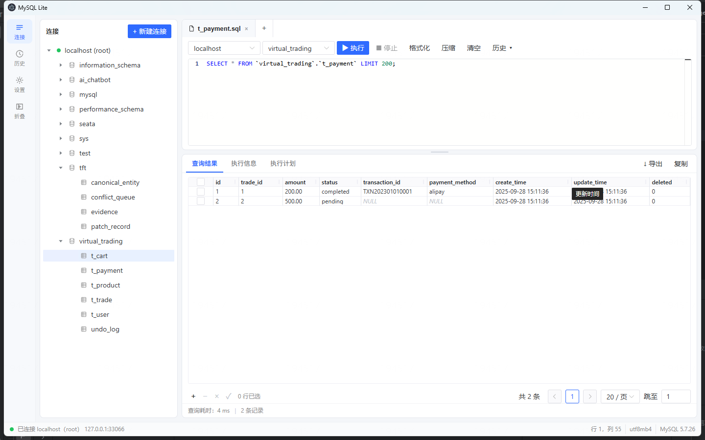

# MySQL Lite

轻量、专注日常查询的 Windows MySQL 桌面客户端。  
维护者：[NealWizard](https://github.com/NealWizard) · [MIT License](LICENSE)



## 亮点

- **开箱即用**：连接树浏览库表，双击表即可出 `LIMIT 200` 查询并自动执行
- **安全默认**：只读模式默认开启；危险语句二次确认；密码经系统加密存储，不明文落盘
- **好写 SQL**：Monaco 编辑器 + 关键字/表/列补全；格式化、压缩、Ctrl+Enter 执行当前语句
- **结果可改**：单表且含主键时可直接改格子、增删行并写回；CSV 导出带 BOM，Excel 中文不乱码
- **表结构可视化**：字段/索引表格编辑，保存前确认一条 `ALTER`，避免误改
- **大结果不卡死**：无 `LIMIT` 的查询按批预览（每批 1000 行），可翻下一批

## 快速开始

```powershell
npm install
npm run dev          # 开发运行
npm run pack:win     # 打 Windows 安装包 → release/
```

若 Electron 下载失败，可先设置镜像：

```powershell
$env:ELECTRON_MIRROR="https://npmmirror.com/mirrors/electron/"
npm install
```

## 技术栈

Electron · Vue 3 · TypeScript · Monaco · naive-ui · mysql2

## 更多文档

完整功能说明与回归清单见 [docs/功能文档.md](docs/功能文档.md)。
